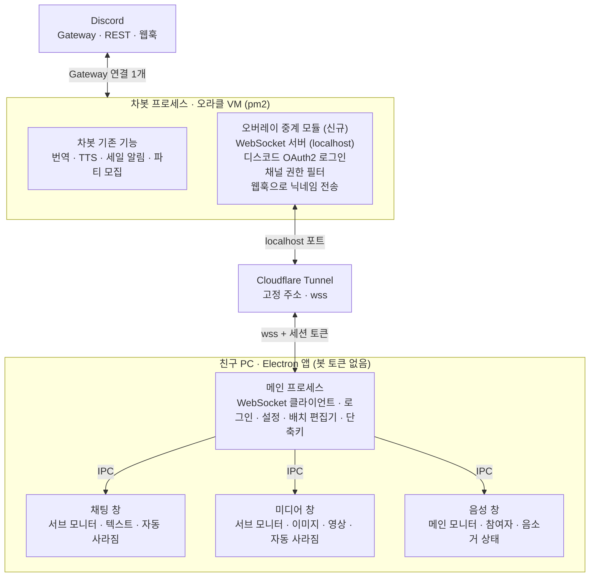

# 디스코드 오버레이 설계

2026-10-21 · 원본: [Claude 문서](https://claude.ai/artifact/U57aiGAUrjezFe5rksiURD)

## 개요

디스코드 클라이언트 없이 채팅 송수신과 음성 참여자 목록을 화면 오버레이로 보는 데스크톱 앱. 친구들도 쓸 수 있게 오라클에서 돌고 있는 차봇에 중계 모듈을 붙이고, 각자 PC에는 봇 토큰이 없는 Electron 앱만 배포함.

- **범위 (MVP)**: 지정 채널 채팅 표시와 전송, 음성 채널 참여자와 음소거 상태 표시, 듀얼 모니터 배치
- **대상**: 한일 친구 서버 멤버 (수 명~수십 명)
- **비목표**: 셀프봇, 디스코드 클라이언트·StreamKit 의존, 게임에 주입하는 오버레이, 음성 통화 자체, DM 표시
- **전제**: 게임은 테두리 없는 창 모드, 음성 통화는 폰 등 다른 기기로 참여

## 전체 아키텍처

디스코드와의 Gateway 연결은 서버에 1개만 있고, 친구들의 앱은 Cloudflare Tunnel을 거쳐 WebSocket으로 서버에 붙음.



봇은 데이터를 받아 나눠주기만 하고, 화면 표시는 각자 PC의 앱이 맡음.

## 서버 설계

차봇 프로세스 안에 `overlay/` 모듈을 추가함. discord.js 클라이언트를 같이 쓰므로 Gateway 연결은 1개 그대로이고, 기존 기능 코드는 건드리지 않음. 서버 코드는 `kuruma-bot` 저장소에서 관리함.

### 인텐트

- `GuildMessages`, `MessageContent`: 채팅 수신. 번역 기능 때문에 이미 켜져 있을 가능성 높음
- `GuildVoiceStates`: 음성 참여자와 음소거 상태. TTS 때문에 이미 사용 중일 가능성 높음
- 멤버 이름과 아바타는 메시지·음성 상태에 포함되므로 `GuildMembers`는 불필요

### 로그인 (디스코드 OAuth2)

1. 앱이 `127.0.0.1:<고정 포트>`에 임시 HTTP 서버를 띄우고 브라우저로 디스코드 인가 페이지를 엶 (`identify` 범위)
2. 리다이렉트로 받은 code를 앱이 중계 서버에 전달
3. 서버가 client secret으로 토큰을 교환해 디스코드 사용자 ID를 확인하고, 자체 세션 토큰을 발급
4. 앱은 세션 토큰을 `safeStorage`로 암호화해 보관하고, 이후 WebSocket 접속 때 사용

client secret은 서버에만 두고 앱에는 client ID만 넣음.

### 권한 필터

- 접속한 사용자가 대상 길드 멤버인지 `guild.members.fetch(id)`로 확인
- 채널은 그 멤버가 `ViewChannel` 권한을 가진 것만 구독 허용 (`channel.permissionsFor(member)`)
- 오버레이 대상 채널은 `.env`의 화이트리스트로 지정. MVP는 친구 서버 한 곳만

### 전송

- 채널마다 웹훅 1개를 차봇이 만들어 재사용
- `username`은 그 사람의 서버 닉네임, `avatar_url`은 본인 아바타로 보내서 누가 쓴 글인지 보이게 함
- 기존 웹훅 자동 번역이 이 메시지를 번역할지 무시할지 정해야 함 (미결 사항)

### 데이터 처리

- 메시지는 메모리에서 중계만 하고 저장·로그를 남기지 않음
- 접속 직후 최근 20개는 `channel.messages.fetch({ limit: 20 })`로 가져와 전달
- 본문은 `cleanContent`로 보내서 `<@id>` 같은 멘션을 이름으로 바꿈

## 클라이언트 설계

Electron 앱 하나에 오버레이 창 3개와 설정 창 1개를 둠. 각 오버레이가 어느 모니터의 어디에 뜰지는 사용자가 설정 창에서 직접 배치함.

### 오버레이 창

| 창 | 기본 모니터 | 기본 위치 | 표시 내용 | 자동 사라짐 | 상호작용 |
| --- | --- | --- | --- | --- | --- |
| 채팅 | 서브 | 우하단 | 텍스트 메시지 최근 5줄 | 5초 / 10초 / 끄기 중 선택 | 단축키로 입력 모드 |
| 미디어 | 서브 | 채팅 창 옆 | 이미지, GIF, 영상 (음소거 자동재생) | 5~10초 중 선택 | 없음 (항상 클릭 통과) |
| 음성 | 메인 | 좌상단 | 참여자, 음소거·스피커 꺼짐 | 없음 (상시 표시) | 없음 (항상 클릭 통과) |

- 이미지·영상이 붙은 메시지는 채팅 창에 텍스트만 띄우고 첨부는 미디어 창으로 보냄. 텍스트 없이 첨부만 있으면 채팅 창에 `[이미지]` 한 줄만 표시
- 미디어 창은 한 번에 1개를 띄우고, 여러 개가 오면 대기열 순서대로 표시. 최대 크기를 정해 두고 비율을 유지해서 축소
- 영상은 음소거 자동재생이며 사라지는 시간이 되면 재생 중이어도 닫음. 파일이 크면 첫 프레임 썸네일만 표시
- Tenor GIF 같은 링크 임베드도 `embeds`의 이미지·영상을 미디어 창으로 보냄
- 사라질 때는 0.5초 페이드아웃

### 모니터와 배치 설정

- 첫 실행 때 `screen.getAllDisplays()`로 모니터 목록을 읽어서 **메인 / 서브**를 고르게 함 (게임 쪽 = 메인, 유튜브 쪽 = 서브가 기본 추천)
- 오버레이마다 띄울 모니터를 메인·서브 중에서 선택, 끄기도 가능
- **배치 편집기**: 설정 창에 실제 해상도 비율대로 모니터 모양을 그리고, 그 안에서 각 오버레이 상자를 드래그로 옮기거나 크기를 조절함. 모서리 근처에서는 자석처럼 붙게 함
- 위치는 픽셀이 아니라 모니터 기준 비율(0~1)로 저장해서 해상도가 바뀌어도 유지
- 모니터는 `display.id`로 기억하고, 연결이 바뀌면 `screen`의 `display-added` / `display-removed` 이벤트로 재배치. 저장된 모니터가 없으면 주 모니터로 대체
- 설정은 사용자 데이터 폴더의 `config.json`에 저장

### 공통 창 옵션

```js
new BrowserWindow({
  transparent: true, frame: false, focusable: false,
  skipTaskbar: true, resizable: false, hasShadow: false,
});
win.setAlwaysOnTop(true, 'screen-saver');
win.setIgnoreMouseEvents(true, { forward: true });
win.showInactive();
```

- 게임이 항상 위를 가로챌 때를 대비해 5초마다 `setAlwaysOnTop`을 다시 적용

### 입력 모드

- 글로벌 단축키 `Ctrl+Shift+D`로 채팅 창의 클릭 통과를 끄고 입력창에 포커스
- Enter로 전송한 뒤 자동 복귀, Esc로 취소
- 입력 모드 동안에는 채팅이 사라지지 않음
- MVP는 기본 채널 1개, 이후 입력창 옆에 채널 선택 추가

### 기타

- 트레이 아이콘: 오버레이 표시·숨김, 설정, 로그아웃, 종료
- 서버 연결이 끊기면 지수 백오프로 재접속하고, 음성 창 구석에 연결 끊김 아이콘을 표시

## 메시지 프로토콜

WebSocket 위에 JSON 메시지를 주고받음. 모든 메시지는 `{ "type": ..., ...payload }` 형태임.

| 방향 | type | 주요 필드 | 설명 |
| --- | --- | --- | --- |
| 앱 → 서버 | `auth` | `token` | 세션 토큰으로 인증 |
| 앱 → 서버 | `subscribe` | `guildId`, `channelIds[]`, `voiceChannelIds[]` | 받을 채널 지정 |
| 앱 → 서버 | `send` | `channelId`, `content`, `nonce` | 메시지 전송 요청 |
| 앱 → 서버 | `ping` | | 30초마다 연결 확인 |
| 서버 → 앱 | `ready` | `user`, `guilds[].channels[]` | 인증 성공, 볼 수 있는 채널 목록 |
| 서버 → 앱 | `history` | `channelId`, `messages[]` | 구독 직후 최근 20개 |
| 서버 → 앱 | `message` | `id`, `channelId`, `author`, `content`, `media[]`, `ts` | 새 메시지 |
| 서버 → 앱 | `message_delete` | `id`, `channelId` | 삭제된 메시지를 화면에서 제거 |
| 서버 → 앱 | `voice` | `channelId`, `members[]` | 해당 음성 채널 참여자 전체 목록 |
| 서버 → 앱 | `sent` | `nonce`, `ok`, `error?` | 전송 결과 |
| 서버 → 앱 | `error` | `code`, `message` | 인증 실패, 권한 없음, 레이트 리밋 등 |

- `author` = `{ id, name, avatar, color }`. `color`는 서버 역할 색
- `media[]` = `{ kind: "image" | "gif" | "video", url, width, height, size }`. 첨부와 임베드를 서버에서 합쳐서 보냄
- `members[]` = `{ id, name, avatar, selfMute, selfDeaf, serverMute, streaming }`
- `voice`는 변경분이 아니라 채널 전체 목록을 매번 보냄. 인원이 적어서 이쪽이 단순하고 꼬이지 않음
- 첨부 URL은 디스코드 CDN의 서명된 주소라 시간이 지나면 만료되지만, 바로 표시하고 사라지는 용도라 문제없음

## 보안·운영

비밀값은 전부 서버에만 두고, 외부 접속은 Cloudflare Tunnel 하나로만 받음.

- **비밀값**: 봇 토큰, OAuth client secret, 세션 서명 키는 서버 `.env`에만 둠. 앱에는 client ID와 서버 주소만 들어감
- **접속 경로**: 중계 모듈은 `localhost` 포트로만 열고 Cloudflare Tunnel이 바깥으로 연결함. 오라클 보안 목록에 인바운드 포트를 추가하지 않아도 되고, 임시 IP가 바뀌어도 주소가 유지됨
- **도메인**: 고정 주소 터널은 Cloudflare에 등록된 도메인이 필요함. 임시 터널(trycloudflare)은 재시작마다 주소가 바뀌어서 배포용으로 부적합
- **레이트 리밋**: 사용자당 전송 1초 1건, 본문 2000자 제한을 서버에서 검사
- **로그**: 접속한 사용자 ID와 시간만 남기고 메시지 내용은 기록하지 않음
- **서버 자원**: 기존 VM(1GB RAM)으로 연결 수십 개는 충분함
- **서버 배포**: 차봇의 기존 GitHub Actions 자동 배포 경로를 그대로 사용
- **앱 배포**: `electron-builder`로 Windows 설치 파일을 만들어 GitHub Releases에 올리고 `electron-updater`로 자동 업데이트. 코드 서명이 없어서 첫 실행 때 SmartScreen 경고가 뜨는 점을 친구들에게 미리 안내
- **공지**: 오버레이가 채널 내용을 앱으로 중계한다는 점을 서버에 공지

## 구현 단계와 미결 사항

본인 PC에서 채팅 표시까지 먼저 돌려보고, 인증과 배포는 마지막에 붙임.

1. 서버: 중계 모듈 뼈대. 임시 고정 토큰으로 본인만 로컬 접속
2. 클라이언트: 채팅 창 1개, 수신 표시와 자동 사라짐
3. 미디어 창 추가, 대기열과 자동 사라짐
4. 음성 창 추가, 메인·서브 모니터 배치
5. 설정 창과 배치 편집기
6. 입력 모드와 웹훅 전송
7. OAuth2 로그인, 권한 필터, Cloudflare Tunnel 연결
8. 설치 파일 배포, 친구 2~3명 베타 테스트
9. (선택) 말하는 사람 표시: 차봇 TTS의 음성 연결과 충돌하지 않는지 검토 후 진행

### 미결 사항

- [ ] 오버레이 채팅에 원문과 차봇 번역 메시지를 둘 다 띄울지, 한쪽만 띄울지
- [ ] 앱에서 보낸 웹훅 메시지를 차봇 자동 번역 대상에 넣을지
- [ ] Cloudflare에 연결할 도메인이 있는지
- [ ] 앱 이름
- [ ] 오버레이 대상 채널 목록
